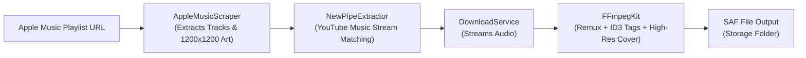

<h1 align="center">Apple Music Playlist Downloader</h1>

<p align="center">
  <strong>An Android application that scrapes Apple Music playlists, matches high-quality audio streams, tags full ID3 metadata with 1200x1200 album artwork, and saves them directly to device storage.</strong>
</p>

---

## 🔒 Technical Note on Apple Music Audio & DRM

> **Important Disclosure on DRM and Stream Sourcing:**
> Apple Music's native audio streams are encrypted using **Apple FairPlay Streaming (FPS) DRM** (Widevine/FairPlay AES-128-CBC encryption with proprietary session key exchange). Direct decryption of these streams is technically prohibited, bypasses digital rights management, and violates copyright and terms of service.
> 
> Consistent with the architecture of the original project (*Spotify Playlist Downloader*), this app **does not circumvent DRM**. Instead, it:
> 1. Extracts track metadata (Song Title, Artist, Album, high-resolution 1200x1200 artwork) directly from public Apple Music playlist web structures.
> 2. Resolves and matches the corresponding public audio streams via YouTube Music using [NewPipe Extractor](https://github.com/TeamNewPipe/NewPipeExtractor).
> 3. Uses [FFmpegKit](https://github.com/arthenica/ffmpeg-kit) to remux/transcode the audio and embed the Apple Music metadata and 1200x1200 album artwork into clean, tagged MP3/M4A files.

---

## ✨ Features

- 🎵 **Direct Apple Music Scraping**: Fast scraping of public Apple Music playlists (`music.apple.com/.../playlist/...`) without requiring Apple Developer tokens or user subscriptions.
- 🖼️ **1200x1200 Ultra HD Artwork**: Automatically extracts the master artwork URL and dynamically requests 1200x1200 resolution for embedding into ID3 tags.
- 📲 **Seamless Android Share Integration**: Share playlist URLs directly from the Apple Music app or browser via Android's native share sheet.
- 🎧 **Audio Stream Matching**: Utilizes [NewPipe Extractor](https://github.com/TeamNewPipe/NewPipeExtractor) to resolve the highest-quality public audio streams from YouTube Music.
- ⚡ **FFmpeg Tagging & Conversion**: Powered by FFmpegKit for fast remuxing, embedding high-res album art and ID3 metadata (Title, Artist, Playlist Curator), and optional MP3 conversion.
- 📂 **Storage Access Framework (SAF)**: Choose any destination directory on external or internal storage.
- 🔄 **Queue Management**: Real-time progress indicators per track, cancelation, and retry mechanisms.
- 🔔 **Foreground Download Service**: Reliable background downloads with a persistent notification and live progress updates.
- 🎨 **Modern Material 3 UI**: Clean Jetpack Compose UI supporting Dark and Light modes.

---

## 🚀 How It Works



1. **Paste or Share Link**: Provide any public Apple Music playlist URL (e.g. `https://music.apple.com/us/playlist/todays-hits/pl.f4d106fed2bd41149aaacabb233eb5eb`).
2. **Metadata Extraction**: `AppleMusicScraper` requests the page using a desktop user agent and extracts JSON-LD and server serialized data to discover all tracks, artists, and artwork templates (`{w}x{h}bb.{f}`).
3. **Stream Matching**: For each track, `NewPipeExtractor` searches YouTube Music for the closest audio stream match.
4. **Tag & Remux**: `FFmpegKit` downloads and muxes the audio, embeds the 1200x1200 cover art and ID3 metadata.
5. **Storage**: The finished file is written directly to the user's selected SAF directory.

---

## 🛠️ Build and Setup Instructions

### Prerequisites
- **JDK**: Java 17 or Java 21+ (Tested with OpenJDK 22)
- **Android SDK**: `platforms/android-34`, `build-tools/34.0.0`
- **Gradle**: 8.9 (or Gradle Wrapper)

### 1. Build the APK

Clone or open the repository directory:
```bash
cd /Users/rudranshupratik/.gemini/antigravity/scratch/apple-music-playlist-downloader
```

Build the debug APK using Gradle:
```bash
./gradlew assembleDebug
```
The output APK will be generated at:
`app/build/outputs/apk/debug/app-debug.apk`

### 2. Run Tests

To execute the unit tests against live Apple Music playlists:
```bash
./gradlew testDebugUnitTest
```

---

## 🧪 Verified Public Playlists

The scraper and parser have been tested and verified on:
- **Today’s Hits**: `https://music.apple.com/us/playlist/todays-hits/pl.f4d106fed2bd41149aaacabb233eb5eb` (50 tracks)
- **Top 100: USA**: `https://music.apple.com/us/playlist/top-100-usa/pl.606afcbb70264d2eb2b51d8dbcfa6a12` (100 tracks)

---

## 👤 Credits

- **Modified by:** Rudranshu Pratik (Apple Music adaptation)
- **Original project:** [Spotify Playlist Downloader](https://github.com/supersu-man/spotify-playlist-downloader) by Sumanth Perambuduri, MIT License
